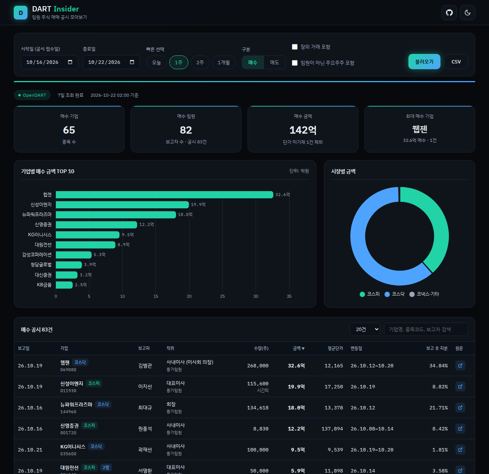
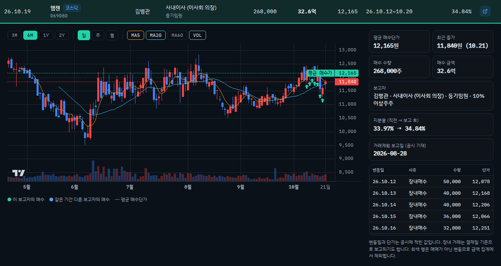

# DART Insider

임원이 자기 회사 주식을 사고판 공시만 모아 보는 웹 서비스입니다.
금융감독원 OpenDART의 **임원ㆍ주요주주특정증권등소유상황보고서**를 읽어 실제 매매만 골라내고, 공시에 적힌 단가로 금액과 평균단가를 계산합니다.

https://dart-insider.vercel.app



## 왜 만들었나

DART 공시 목록에서 "소유상황보고서"는 하루에 수십 건씩 올라오지만, 그중 상당수는 매수가 아닙니다.
주식매수선택권 행사, 증여, 주식병합, 합병, 신규상장, 신규 선임 때 기존 보유분 신고까지 모두 같은 보고서로 들어옵니다.
보유 수량이 늘었다는 사실만으로는 임원이 돈을 내고 샀는지 알 수 없어서, 공시 원문(`document.xml`)의 세부변동내역을 직접 파싱해 매매만 남기도록 했습니다.

## 할 수 있는 것

- 공시 접수일 기준으로 기간 조회 (한 번에 최대 31일, 최근 1년)
- 매수/매도 전환, 장외 거래와 임원이 아닌 주요주주(10% 이상 주주 등) 포함 여부 선택
- 기업별 금액 TOP 10, 시장별 금액, 같은 기간 같은 종목을 매매한 보고자 수 표시
- 행을 누르면 일/주/월봉 차트에 매매 시점과 평균단가를 표시하고, 공시에 적힌 거래 내역을 보여줌
- CSV 내보내기, 다크/라이트 테마, 모바일 화면



## 분류 기준

| 공시의 보고사유 | 처리 |
| --- | --- |
| 장내매수(+), 장내매도(-) | 매수 / 매도 |
| 시간외매매(+/-) | 매수 / 매도 |
| 장외매수(+), 장외매도(-) | 매수 / 매도 (기본은 제외, 체크하면 포함) |
| 주식매수선택권, 유상증자, 증여·수증, 상속, 합병, 주식병합, 신규상장, 신규선임 등 | 제외 |

- 보통주와 우선주만 집계합니다. 전환사채, 신주인수권 같은 다른 증권은 제외합니다.
- 정정 공시는 최종본만 씁니다 (OpenDART `last_reprt_at=Y`). 다만 캐시가 남아 있는 동안(최근 1주일 날짜는 30분)은 정정 전 공시가 함께 보일 수 있습니다.
- 금액은 각 거래 행의 `수량 × 공시 단가` 합계입니다. 단가가 비어 있는 행은 금액에서 빠집니다. 일부만 빠진 공시는 표에 `*`, 단가가 하나도 없으면 `-`로 표시합니다.
- 변동일과 단가는 공시에 적힌 그대로입니다. 장내 거래는 결제일 기준으로 보고되는 경우가 있어 체결일과 다를 수 있습니다.

## 실행

Python 3.11 이상과 [OpenDART API 키](https://opendart.fss.or.kr)가 필요합니다.

```bash
python -m venv .venv && source .venv/bin/activate
pip install -r requirements.txt
cp .env.example .env          # DART_API_KEY 입력
python server.py              # http://localhost:8080
```

테스트는 `pip install -r requirements-dev.txt && pytest`로 돌립니다. 파서 테스트는 실제 공시 구조를 본뜬 픽스처를 쓰고, API 테스트는 OpenDART 응답을 모킹하므로 키 없이 실행됩니다.

## 구조

- `server.py` FastAPI 서버. `GET /api/filings/{YYYYMMDD}`는 그날 접수된 소유상황보고서를 모두 받아 매매가 있는 건만 돌려주고, `GET /api/prices/{종목코드}`는 차트용 일봉을 돌려줍니다.
- `filings.py` 공시 원문 파서. 원문 XML이 엄격한 XML이 아니라서 `ACODE`/`AUNIT` 속성이 붙은 셀만 정규식으로 읽습니다.
- `index.html` 화면 전체 (vanilla JS, Chart.js, Lightweight Charts).

DB 없이 요청 시점에 OpenDART를 호출합니다. 날짜 하나가 요청 하나라서 응답을 Vercel CDN에 날짜별로 캐시할 수 있습니다 (오늘 5분, 최근 1주일 30분, 그 이전 6시간). 원문 파싱 결과는 서버 메모리에도 보관합니다.
OpenDART는 짧은 시간에 요청이 몰리면 IP를 차단하므로 서버 인스턴스마다 호출을 초당 8회로 제한하고, 인스턴스당 하루 15,000회(키 한도는 20,000회)를 넘기면 더 호출하지 않습니다. 인스턴스끼리 공유하는 카운터는 아니어서 키 한도를 완벽하게 지켜 주지는 못합니다.
정해진 시간 안에 받지 못한 원문은 `pending`으로 돌려주고, 화면이 같은 날짜를 다시 요청해 이어서 받습니다.

## 배포

Vercel에서 FastAPI 프리셋으로 동작합니다. `main`에 push하면 Production으로 배포됩니다.

- 환경 변수 `DART_API_KEY`가 필요합니다. 없으면 API가 503과 함께 안내 메시지를 돌려줍니다.
- `vercel.json`에서 함수 리전을 서울(`icn1`)로 지정했습니다. 해외 리전에서는 OpenDART 접속이 막힐 수 있습니다.
- 그래도 OpenDART가 서버 IP를 거부하면(status 012) 국내에 둔 OpenDART 호환 프록시 주소를 `DART_BASE_URL`로 지정합니다.

## 한계

- 캐시가 비어 있는 날짜는 원문을 한 건씩 받아야 해서 처음 조회가 느립니다. 1주일 조회에 수십 초가 걸릴 수 있습니다.
- 주가는 네이버 금융의 비공식 차트 API를 씁니다. 예고 없이 막히거나 바뀔 수 있고, 그래도 공시 조회는 그대로 동작합니다.
- 공시는 거래 후 며칠 뒤에 제출되므로 실시간 정보가 아닙니다. 투자 판단 전에 원문을 확인하세요.

## English

DART Insider lists share purchases and sales by executives of Korean listed companies.
It reads insider ownership reports (임원ㆍ주요주주특정증권등소유상황보고서) from the FSS OpenDART API, parses the change table inside each original filing, and keeps only actual trades: on-market, after-hours and, optionally, off-market. Stock option exercises, rights issues, gifts, mergers, reverse splits and new listings are left out, and amounts are computed from the unit prices stated in the filing. Clicking a row opens a price chart with the trade dates and the average trade price marked.

Built with FastAPI and plain JavaScript (Chart.js, TradingView Lightweight Charts), deployed on Vercel. Set `DART_API_KEY` to run it.

## License

MIT
